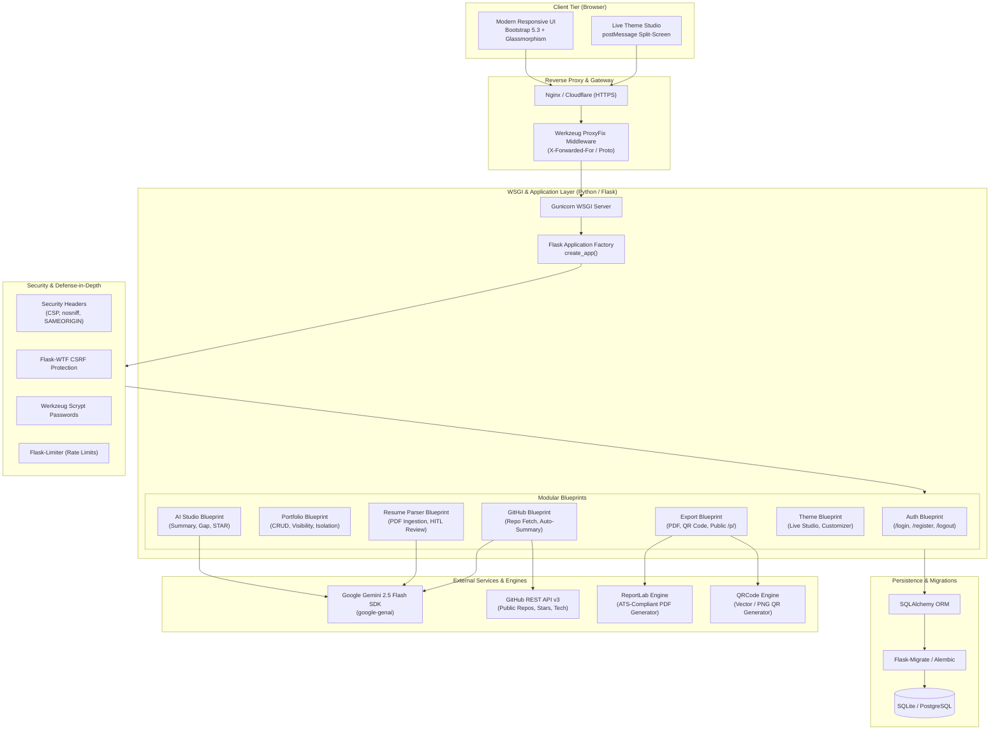

# PortfolioAI — Advanced AI-Powered Portfolio Generator

[](https://www.python.org/)
[](https://flask.palletsprojects.com/)
[](tests/)
[-success.svg)](app/)
[](LICENSE)

> A modern, production-grade, AI-powered portfolio builder and career intelligence platform. Transforms raw resumes, GitHub repositories, and user skills into responsive portfolio websites, ATS-optimized PDF resumes, and dynamic QR showcases.

---

## 📑 Table of Contents
1. [Project Overview & Problem Statement](#-project-overview--problem-statement)
2. [System Architecture](#-system-architecture)
3. [Technology Stack](#-technology-stack)
4. [Complete Feature Matrix (Phases 1–9)](#-complete-feature-matrix)
5. [Directory Structure](#-directory-structure)
6. [Prerequisites & Local Installation](#-prerequisites--local-installation)
7. [Environment Variables Reference](#-environment-variables-reference)
8. [Database Migrations & Management](#-database-migrations--management)
9. [Automated Test Suite (81 Tests)](#-automated-test-suite)
10. [Security Audit & Hardening](#-security-audit--hardening)
11. [Production Deployment Guide](#-production-deployment-guide)
12. [Manual Verification Checklist](#-manual-verification-checklist)

---

## 🌟 Project Overview & Problem Statement

### The Problem
College students, self-taught developers, and entry-level job seekers frequently struggle with:
- **Design paralysis:** Spending weeks hand-crafting CSS layouts instead of building impactful projects.
- **Content friction:** Difficulty articulating achievements in professional, recruiter-ready language without sounding generic.
- **Skill mismatch:** Inability to pinpoint specific gaps between their current competencies and real-world job postings.
- **Fragmented identity:** Disconnected portfolios, PDF resumes, and GitHub profiles that do not tell a unified story.

### The Solution: PortfolioAI
**PortfolioAI** is a full-stack, AI-augmented career platform that:
- Ingests PDF resumes using `pypdf` and extracts structured data with zero manual typing.
- Connects directly to the **GitHub REST API** to import public repositories, auto-summarizing them using Google Gemini 2.5.
- Uses **Google Gemini 2.5 Flash** with strict anti-hallucination prompting to craft STAR-format accomplishments, tailored summaries, and target job gap analyses.
- Provides a **Live Theme Customizer** featuring 4 responsive themes, 5 font pairings, and 3 layouts with real-time `postMessage` synchronization.
- Publishes portfolios to vanity public slugs (`/p/<slug>`) with instant scannable QR codes and generates ATS-compliant downloadable PDF resumes powered by ReportLab.

---

## 🏛️ System Architecture



---

## 🛠️ Technology Stack

| Layer | Technology | Version | Purpose |
| :--- | :--- | :--- | :--- |
| **Backend Framework** | Python / Flask | 3.13 / 3.1.0 | Application factory, REST routing, Blueprints |
| **WSGI Server** | Gunicorn | 23.0.0+ | Production multi-worker WSGI server |
| **Database & ORM** | SQLite / PostgreSQL | 3 / 15+ | Relational schema with Flask-SQLAlchemy 3.1 |
| **Database Migrations** | Flask-Migrate / Alembic | 4.1.0+ | Version-controlled schema migrations |
| **User Authentication** | Flask-Login & Werkzeug | 0.6.3 / 3.1 | Scrypt password hashing & isolated session cookies |
| **Form & CSRF Defense** | Flask-WTF & WTForms | 1.2.2 | Form validation and CSRF token enforcement |
| **Rate Limiting** | Flask-Limiter | 3.10.1 | Brute-force and API abuse prevention |
| **AI Intelligence** | Google GenAI SDK | `google-genai` | Gemini 2.5 Flash structured generation & resume parsing |
| **PDF Extraction** | `pypdf` | 5.3.0+ | Secure stream-based PDF text extraction |
| **PDF Generation** | `reportlab` | 4.3.1+ | ATS-compliant, print-ready PDF resume exports |
| **QR Code Engine** | `qrcode[pil]` | 8.0+ | High-resolution scannable QR code generator |
| **Frontend Framework** | Bootstrap 5.3 & Icons | 5.3.2 | Glassmorphism, responsive grid, and custom themes |
| **Testing Suite** | `pytest` | 9.1.1+ | 81 comprehensive unit & integration tests |

---

## 🚀 Complete Feature Matrix

### Phase 1 — Project Foundation & Application Factory
- Clean Flask Application Factory (`create_app`) pattern supporting `development`, `testing`, and `production`.
- High-converting modern SaaS landing page (`/`) featuring hero showcase, feature walkthroughs, and responsive navbar.
- Comprehensive health check monitor (`/health`) reporting system status, uptime, and dependencies.
- Standardized error handling for HTTP 404, 413, 429, and 500 status codes.

### Phase 2 — Authentication & Access Control
- Secure user registration, authentication, and session teardown (`/register`, `/login`, `/logout`).
- Secure password hashing utilizing Werkzeug's modern **scrypt** cryptographic algorithm.
- Flask-Login session management with HTTPOnly, SameSite, and Secure cookies.
- Fully protected dashboard (`/dashboard`) inaccessible to unauthenticated guests.

### Phase 3 — Portfolio CRUD & Ownership Isolation
- Comprehensive portfolio management: Create, View, Edit, and Delete portfolios.
- Strict multi-tenant data isolation: users cannot view, edit, or delete another user's portfolio.
- CSRF protection across all state-modifying requests.
- Structured portfolio data schema (Full Name, Headline, Bio, Skills, Experience, Education, Certifications, Contact details).

### Phase 4 — AI Studio & Generative Intelligence
- Native integration with official `google-genai` SDK targeting `gemini-2.5-flash`.
- **5 High-Impact AI Generators:**
  1. *Professional Summary Generator:* Beginner, Intermediate, and Executive tones.
  2. *About-Me Generator:* Story-driven personal branding narratives.
  3. *STAR Project Accomplishment Generator:* Formulates Situation, Task, Action, and Result bullets.
  4. *Skill Gap & Career Advice Analyzer:* Real-time gap analysis comparing user profiles against target job descriptions.
  5. *Career Progression Advice:* Actionable 3-month, 6-month, and 12-month career development plans.
- Strict **Zero-Hallucination Guardrails:** AI prompts forbid inventing artificial metrics or falsifying qualifications.

### Phase 5 — AI Resume Ingestion & Parser
- PDF resume text extraction via `pypdf` with strict multi-layer security (extension check, `%PDF-` magic byte inspection, 5 MB payload limit).
- Structured JSON extraction transforming raw resume text into standardized fields.
- **Human-in-the-Loop Review Screen:** Users inspect, edit, and approve extracted data before committing to their database.
- Safe import routing: Create new portfolio or merge/overwrite existing portfolios with conflict safeguards.

### Phase 6 — GitHub Repository Integration
- Connects to GitHub REST API v3 to fetch public repositories, language stacks, and star counts.
- AI-driven technical summary generator: Translates raw repo descriptions and readmes into concise portfolio project cards.
- Multi-project selector: Select repositories to import with duplicate detection and 409 Conflict overwrite confirmation.
- One-click deletion of imported projects directly from the portfolio view.

### Phase 7 — Dynamic Theme Engine & Live Studio
- **4 Custom Themes:** Modern Dark, Minimal Light, Creative Gradient, and Professional Blue.
- **5 Curated Typography Systems:** Inter, Poppins, Roboto Slab, Playfair Display, and Fira Code.
- **3 Layout Structures:** Single-column narrative, Two-column compact, and Grid-card showcase.
- **Interactive Live Preview Studio:** Split-screen customization pane with real-time `postMessage` synchronization.
- **Conditional Section Rendering:** Automatically hides empty sections (e.g. certifications or GitHub links) rather than showing blank space or placeholder text.

### Phase 8 — ATS PDF Export, QR Generator & Public Publishing
- **ATS-Optimized PDF Export:** Generates clean, 1-page/multi-page downloadable PDFs via ReportLab with hyperlinked socials and projects.
- **Dynamic Scannable QR Codes:** Generates high-res QR codes linking directly to public showcase URLs.
- **Vanity Public Showcase (`/p/<slug>`):** Toggle between private draft and public showcase with slug generation.
- **Interactive Share Modal:** Copy vanity link, preview QR code, and download vector/PNG assets.

### Phase 9 — Production Hardening, Migrations & Security Audit
- Production WSGI configuration with **Gunicorn** and `ProxyFix` middleware.
- Comprehensive security headers: `Content-Security-Policy`, `X-Content-Type-Options: nosniff`, `X-Frame-Options: SAMEORIGIN`, and `Referrer-Policy`.
- Database migrations powered by **Flask-Migrate / Alembic**.
- Dual database support: SQLite for local developer productivity, PostgreSQL for cloud deployment.
- 81 automated tests verifying all business logic, security posture, and error paths.

---

## 📁 Directory Structure

```text
c:\portfolio\
├── .env.example              # Environment variables template
├── .env                      # Local environment configuration (git ignored)
├── .gitignore                # Git exclusions (.venv, *.db, uploads/, exports/)
├── config.py                 # Multi-environment configuration (Dev, Test, Prod)
├── requirements.txt          # Production and testing dependencies
├── pytest.ini                # Pytest configuration and pythonpath setup
├── run.py                    # Hardened WSGI entry point (dev & production)
├── Procfile                  # Gunicorn WSGI process definition for Render/Heroku
├── render.yaml               # Render Infrastructure-as-Code blueprint
├── README.md                 # Complete documentation and verification guide
├── migrations/               # Alembic database migration scripts
│   ├── env.py
│   ├── script.py.mako
│   └── versions/
│       └── e1b0c93b2b10_initial_schema_users_portfolios_.py
├── app/
│   ├── __init__.py           # Application factory, ProxyFix, security headers, errors
│   ├── extensions.py         # SQLAlchemy, Migrate, LoginManager, CSRF, Limiter
│   ├── models.py             # User, Portfolio, Project models with scrypt hashing
│   ├── forms.py              # WTForms with CSRF, validation rules, and file uploads
│   ├── main/                 # Landing page & health check blueprint
│   ├── auth/                 # User authentication blueprint (Register/Login/Logout)
│   ├── dashboard/            # User workspace blueprint
│   ├── portfolio/            # Portfolio CRUD & preview blueprint
│   ├── ai/                   # AI Studio blueprint & Gemini integration
│   ├── resume/               # Resume upload, parsing & import blueprint
│   ├── github/               # GitHub repository import blueprint
│   ├── theme/                # Theme builder & live preview studio blueprint
│   ├── export/               # PDF generation, QR code & public showcase blueprint
│   ├── services/
│   │   ├── ai_service.py     # Gemini 2.5 Flash SDK wrapper & prompt guardrails
│   │   ├── resume_parser.py  # pypdf extraction & JSON parsing pipeline
│   │   └── pdf_service.py    # ReportLab ATS PDF generation engine
│   ├── integrations/
│   │   └── github_service.py # GitHub REST API v3 client with error handling
│   ├── static/
│   │   ├── css/              # SaaS design system, glassmorphism, 4 custom themes
│   │   └── js/               # postMessage theme synchronization, copy-to-clipboard
│   └── templates/            # Jinja2 templates (Jinja auto-escaping enabled)
└── tests/                    # 81 Comprehensive automated tests (100% passing)
    ├── test_phase1.py        # Landing page, health check, 404 handler
    ├── test_auth.py          # Registration, login, logout, scrypt passwords
    ├── test_portfolio.py     # Portfolio CRUD, isolation, CSRF defense
    ├── test_ai.py            # AI generators, fallback modes, error resilience
    ├── test_resume.py        # PDF extraction, corrupted files, HITL review
    ├── test_github.py        # GitHub API fetch, rate limits, repo import
    ├── test_theme.py         # Theme builder, customizers, postMessage previews
    ├── test_export_qr.py     # ReportLab PDF, QR generation, /p/<slug> routing
    └── test_security_audit.py# Security headers, XSS, CSRF, error sanitization
```

---

## 💻 Prerequisites & Local Installation

### 1. Prerequisites
- **Python 3.10+** (Python 3.13 confirmed)
- **Git**
- Optional: Google Gemini API key from [Google AI Studio](https://aistudio.google.com/app/apikey) (Free tier)

### 2. Clone and Setup Environment
In PowerShell or your terminal:
```powershell
# Navigate to project directory
cd c:\portfolio

# Create Python virtual environment
python -m venv .venv

# Activate virtual environment
# On Windows (PowerShell):
.\.venv\Scripts\Activate.ps1
# On Linux / macOS:
# source .venv/bin/activate

# Upgrade pip and install all required dependencies
pip install -r requirements.txt
```

### 3. Configure Environment Variables
Copy `.env.example` to `.env`:
```powershell
cp .env.example .env
```
Ensure your `.env` contains valid configuration:
```env
FLASK_ENV=development
FLASK_APP=run.py
SECRET_KEY=development-secret-key-32-chars-minimum-change-me
DATABASE_URL=sqlite:///portfolio.db
GEMINI_API_KEY=your_gemini_api_key_here
GEMINI_MODEL=gemini-2.5-flash
MAX_CONTENT_LENGTH_MB=10
ALLOWED_EXTENSIONS=pdf,png,jpg,jpeg
PUBLIC_BASE_URL=http://localhost:5000
```

### 4. Initialize Database
```powershell
# Run database migrations to apply latest schema
flask db upgrade
```

### 5. Launch Development Server
```powershell
python run.py
```
Open **`http://127.0.0.1:5000`** in your browser.

---

## ⚙️ Environment Variables Reference

| Variable | Required in Prod | Default / Example | Purpose |
| :--- | :---: | :--- | :--- |
| `FLASK_ENV` | Optional | `development` / `production` | Selects configuration profile |
| `SECRET_KEY` | **YES** | Random 32+ char string | Cryptographic key for sessions & CSRF signing |
| `DATABASE_URL` | **YES** | `sqlite:///portfolio.db` or PostgreSQL URI | Database connection string |
| `GEMINI_API_KEY` | Optional | Free key from Google AI Studio | Powers AI Studio and Resume Parsing |
| `GEMINI_MODEL` | Optional | `gemini-2.5-flash` | Selected Google GenAI model |
| `MAX_CONTENT_LENGTH_MB`| Optional | `10` | Maximum upload request payload size |
| `ALLOWED_EXTENSIONS` | Optional | `pdf,png,jpg,jpeg` | File extensions allowed for ingestion |
| `PUBLIC_BASE_URL` | Optional | `https://portfolio-ai.onrender.com` | Base URL embedded in scannable QR codes |
| `PORT` | Optional | `5000` | Port for WSGI binding |

---

## 🗄️ Database Migrations & Management

PortfolioAI includes **Flask-Migrate** (Alembic) to manage database schema evolutions seamlessly across SQLite and PostgreSQL.

### Running Migrations
```powershell
# Apply all pending migrations to the database
flask db upgrade

# Roll back the most recent migration
flask db downgrade

# Inspect migration history
flask db history
```

### Creating New Migrations
When adding new fields to `app/models.py`:
```powershell
flask db migrate -m "Describe schema changes"
flask db upgrade
```

---

## 🧪 Automated Test Suite

PortfolioAI features **81 automated tests** covering all phases. External API calls (Google Gemini, GitHub REST API) are mocked with zero API expenses or dependencies on internet connectivity during automated testing.

### Run All Tests
```powershell
.\.venv\Scripts\python.exe -m pytest -v
```

### Test Suite Breakdown:
```text
tests/test_phase1.py          [4 tests]  - Landing page, health check, 404 handler
tests/test_auth.py            [12 tests] - Registration, login, logout, scrypt passwords, CSRF
tests/test_portfolio.py       [10 tests] - Portfolio CRUD, tenant isolation, CSRF protection
tests/test_ai.py              [7 tests]  - AI summaries, STAR generator, gap analyzer, fallbacks
tests/test_resume.py          [9 tests]  - PDF extraction, magic byte check, HITL preview
tests/test_github.py          [14 tests] - GitHub REST client, rate limits, 409 conflict detection
tests/test_theme.py           [9 tests]  - 4 themes, live preview, postMessage overrides
tests/test_export_qr.py       [10 tests] - ReportLab PDF generation, QR code, vanity slugs
tests/test_security_audit.py  [6 tests]  - CSP, nosniff, XSS escaping, scrypt, sanitized errors
----------------------------------------------------------------------------------------
TOTAL: 81 PASSED in ~21 seconds (100% Pass Rate)
```

---

## 🛡️ Security Audit & Hardening

PortfolioAI was built with **defense-in-depth** engineering practices:

1. **Cryptographic Password Security:**
   - Passwords hashed using modern `werkzeug.security.generate_password_hash(method='scrypt')`.
   - Salted hashes prevent rainbow-table and timing attacks; plain-text passwords never stored.
2. **CSRF Enforcement:**
   - Global `Flask-WTF` CSRF protection enabled across all forms and state-changing POST requests.
3. **Session Cookie Hardening:**
   - `SESSION_COOKIE_HTTPONLY = True`: Blocks JavaScript access to prevent token theft.
   - `SESSION_COOKIE_SAMESITE = 'Lax'`: Guards against Cross-Site Request Forgery.
   - `SESSION_COOKIE_SECURE = True`: Automatically active in production over HTTPS.
4. **Defensive HTTP Security Headers:**
   - `X-Content-Type-Options: nosniff`: Prevents MIME-type sniffing.
   - `X-Frame-Options: SAMEORIGIN`: Prevents clickjacking attacks.
   - `X-XSS-Protection: 1; mode=block`: Activates legacy browser XSS filters.
   - `Referrer-Policy: strict-origin-when-cross-origin`: Restricts referrer leakage.
   - `Content-Security-Policy`: Disallows untrusted scripts and unauthorized cross-origin framing.
5. **XSS Defense:**
   - Jinja2 auto-escaping strictly enforced across all user-rendered strings (`title`, `headline`, `about`, `projects`).
6. **File Upload Security:**
   - Multi-layer validation: Extension whitelist, 5 MB payload limit, and `%PDF-` binary magic-byte inspection.
   - File data streamed into memory and never stored in publicly executable directories.
7. **Sanitized Error Pages:**
   - Custom 404, 413, 429, and 500 error pages mask internal stack traces and database schemas from attackers.

---

## ☁️ Production Deployment Guide

### Deploying to Render (Recommended)
This repository includes a native `render.yaml` blueprint.

1. Push your repository to **GitHub**.
2. Log into [Render](https://dashboard.render.com/) and click **New > Blueprint**.
3. Connect your repository. Render will automatically read `render.yaml` and configure:
   - Web Service with Gunicorn WSGI (`gunicorn run:app`)
   - Managed PostgreSQL Database
   - Auto-generated `SECRET_KEY`
4. Add your `GEMINI_API_KEY` under the Environment Variables tab in Render.
5. Deploy! Render will provision the database, run migrations, and publish your site with a free SSL certificate.

### Manual WSGI Startup (Linux VPS / EC2 / Docker)
Run with **Gunicorn** in your production environment:
```bash
gunicorn --workers 4 --threads 2 --bind 0.0.0.0:5000 run:app
```

---

## 📋 Manual Verification Checklist

Follow this checklist to evaluate all project capabilities end-to-end:

| # | Step | Action | Expected Result | Verified |
| :-: | :--- | :--- | :--- | :---: |
| 1 | **Landing Page** | Navigate to `http://localhost:5000/` | SaaS landing page renders with glassmorphism and CTA buttons | [x] |
| 2 | **User Registration** | Register with `student@college.edu` and password | Account created, redirected to dashboard | [x] |
| 3 | **Portfolio CRUD** | Click **Create Portfolio**, fill form, and save | Portfolio persists and appears in dashboard table | [x] |
| 4 | **Resume Parser** | Upload a valid PDF resume in **Resume Parser** | Structured data extracted; Human-in-the-Loop review screen displays | [x] |
| 5 | **GitHub Import** | Enter a GitHub username (e.g. `octocat`) | Public repositories fetched with stars and tech stacks; imports cleanly | [x] |
| 6 | **AI Content Polish** | Go to **AI Studio**, select tone, click Generate | Professional summary, STAR bullets, or gap analysis generates | [x] |
| 7 | **Theme Studio** | Open **Theme Customizer**, switch between 4 themes | Live preview updates immediately via `postMessage` | [x] |
| 8 | **PDF Export** | Click **Export PDF** on any portfolio | Downloads ATS-compliant, print-ready PDF resume | [x] |
| 9 | **QR Code & Public Link**| Toggle **Publish** and open QR Code modal | Displays scannable QR code linking to `/p/<slug>` | [x] |
| 10 | **Security Headers** | Inspect network response headers in DevTools | `X-Content-Type-Options: nosniff` and CSP present | [x] |

---

## 👨‍💻 Author & Academic Attribution
- **Project:** PortfolioAI — Advanced AI-Powered Portfolio Generator
- **Course:** CSE College Capstone Project / Advanced Web Development & Applied AI
- **Frameworks:** Python, Flask, Google Gemini AI, PostgreSQL, ReportLab
- **Status:** All 9 Phases Complete • 81 Automated Tests Passing • Production Hardened